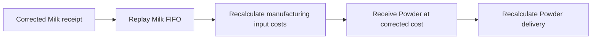

# FIFO stock reposting: Milk to Milk Powder

A historical purchase-cost correction must reach every transaction that depends on that cost, including manufactured products. This repository demonstrates that behavior with a small Python implementation, an executable example, and regression tests.

**Result:** changing the 10 January Milk receipt from INR 60/L to INR 80/L increases manufacturing cost from INR 5,800 to INR 6,800. Milk Powder costs INR 680/kg and its delivery costs INR 6,800. Closing Milk remains **20 L at INR 60/L**, worth INR 1,200.

This is a standalone reference design, not an ERPNext patch. It runs without installing ERPNext or accessing a database. ERPNext already has FIFO valuation and reposting mechanisms; this exercise explains the required behavior rather than claiming those mechanisms are missing.

## Run it

Requires Python 3.11 or newer. Only the Python standard library is used.

```bash
git clone https://github.com/Pandiyan5273/stock-reposting-fifo.git
cd stock-reposting-fifo
python3 example.py
python3 -m unittest -v
```

Try a different corrected receipt rate:

```bash
python3 example.py --rate 75
```

The example prints every ledger row's movement value before and after correction, its new running quantity/value, the remaining Milk queue, and which derived rows changed.

| File | Purpose |
| --- | --- |
| [stock_reposting.py](stock_reposting.py) | FIFO layers, chronological replay, and receipt-correction preview |
| [example.py](example.py) | The assignment's transactions and a command-line comparison |
| [test_stock_reposting.py](test_stock_reposting.py) | Automated tests for valuation and reposting behavior |
| [.github/workflows/tests.yml](.github/workflows/tests.yml) | Run tests and the example on GitHub Actions |

## Scenario and assumptions

| Date | Transaction |
| --- | --- |
| Before 10 January | Opening Milk: 100 L at INR 50/L |
| 10 January | Purchase 50 L Milk at INR 60/L |
| 15 January | Deliver 80 L Milk |
| 20 January | Purchase 50 L Milk at INR 60/L |
| 21 January | Consume 100 L Milk and produce 10 kg Milk Powder |
| 25 January | Deliver 10 kg Milk Powder |

Both items use FIFO. The 10 January incoming rate is corrected to INR 80/L.

The worked calculation assumes one company, INR, one warehouse per item, no other stock, no additional manufacturing costs, no scrap, and no batch/serial overrides. Milk is measured in litres and Powder in kilograms. Their production ratio belongs to the manufacturing transaction, not to an Item UOM conversion. The opening stock is modeled as a receipt before the affected period.

## 1. Which stock transactions are affected?

The original receipt, every subsequent Milk ledger row, and the linked manufacturing output and Powder delivery must be considered. Recalculation does not mean that every movement's own cost changes.

| Ledger movement | Movement value before | Movement value after | Quantity after | Balance value before | Balance value after |
| --- | ---: | ---: | ---: | ---: | ---: |
| Opening Milk | +5,000 | +5,000 | 100 L | 5,000 | 5,000 |
| 10 Jan Milk receipt | +3,000 | +4,000 | 150 L | 8,000 | 9,000 |
| 15 Jan Milk delivery | -4,000 | -4,000 | 70 L | 4,000 | 5,000 |
| 20 Jan Milk receipt | +3,000 | +3,000 | 120 L | 7,000 | 8,000 |
| 21 Jan Milk consumption | -5,800 | -6,800 | 20 L | 1,200 | 1,200 |
| 21 Jan Powder production | +5,800 | +6,800 | 10 kg | 5,800 | 6,800 |
| 25 Jan Powder delivery | -5,800 | -6,800 | 0 kg | 0 | 0 |

All values are INR. Balances belong to the item in that row. The opening row is unchanged. The 15 January delivery and 20 January receipt retain their movement costs but require updated running values and queues.

## 2. How should valuation be recalculated?

Start with the valid queue before the corrected receipt and replay the transactions in posting order:

```text
Opening:           [100 L @ 50]
After 10 Jan:      [100 L @ 50, 50 L @ 80]
After 15 Jan:      [20 L @ 50, 50 L @ 80]
After 20 Jan:      [20 L @ 50, 50 L @ 80, 50 L @ 60]
After manufacture:[20 L @ 60]
```

The 15 January delivery consumes only opening stock: `80 × 50 = 4,000`.

Manufacturing consumes `20 × 50 + 50 × 80 + 30 × 60 = 6,800`. That total becomes the cost of the 10 kg output: `6,800 / 10 = 680/kg`. The 25 January delivery consumes that Powder layer for INR 6,800.

For each ordinary ledger row:

```text
quantity after = previous quantity + signed movement quantity
stock value after = value of the remaining FIFO layers
stock value difference = stock value after - previous stock value
balance valuation rate = stock value after / quantity after, when positive
```

The balance valuation rate summarizes the remaining stock. The next outgoing transaction must still consume FIFO layers; using that average as its issue rate would change the valuation method.

Quantities and sales prices do not change. With perpetual inventory and ordinary expense-on-delivery accounting, the Powder delivery's COGS increases by INR 1,000. A real ERPNext integration must update affected accounting through its existing posting logic; this standalone code does not generate GL entries.

Value conservation provides an independent check:

```text
Before: 5,000 + 3,000 + 3,000 = 4,000 + 5,800 + 1,200 = 11,000
After:  5,000 + 4,000 + 3,000 = 4,000 + 6,800 + 1,200 = 12,000
```

Manufacturing transfers value between items. Counting Milk consumption as an extra external expense would double-count that cost.

## 3. Reposting design

### Implemented reference approach

1. Keep source transactions separate from calculated ledger rows.
2. Copy the source history and correct only the selected receipt rate.
3. Replay both histories in a deterministic order: posting timestamp, explicit sequence, then unique transaction name.
4. Maintain an independent FIFO queue for every `(item, warehouse)`.
5. Process all manufacturing inputs before receiving its single output. Use actual consumed costs plus any explicit additional cost. This also propagates corrections through later manufacturing stages.
6. Rebuild stable ledger row identifiers and compare complete row values to identify changed results.
7. Return the complete result only after successful calculation. The caller's original transactions remain unchanged on success or failure.



This implementation deliberately replays the full supplied history. The bounded example is easy to reason about, and full replay provides a useful correctness baseline for a future incremental implementation. It does not implement a checkpoint or affected-suffix optimization.

### Production extension

For a large ERPNext ledger, start at the earliest affected posting position with a verified preceding checkpoint. Merge overlapping requests by item/warehouse and earliest dirty position. When a manufacturing or transfer cost changes, schedule the corresponding output stream from its incoming entry. Requeue a stream if a newly discovered dependency invalidates an already processed position.

Coordinate conflicting jobs and concurrent submissions/cancellations with locking or version checks. Persist progress, pending dependencies, and results consistently so a restart can safely resume. Recalculate and replace derived values; do not repeatedly add the cost difference. Track stock and accounting completion and expose pending valuation to reports.

A stream can stop early only after all relevant valuation state converges, future inputs remain unchanged, and dependencies have been propagated. Here Milk's final queue matches its old queue, but Powder still needs processing. An unchanged outgoing cost or final balance alone is not a stopping condition.

## 4. Problems with storing a running balance in every SLE

Running quantities, values, and queues support fast historical reporting. They also duplicate derived state:

- A historical correction can require many downstream updates, even where movement costs are unchanged.
- A failed or partly completed repost can leave a mixture of old and new balances.
- Concurrent postings may read stale balances or overwrite another worker's calculations.
- Repeating long FIFO queue snapshots consumes storage and processing time.
- Reposting only the original item misses cost dependencies through manufactured items or warehouse transfers.
- Quantity and value alone lose the ordering required for FIFO.

For example, `[10 @ 50, 10 @ 70]` and `[10 @ 70, 10 @ 50]` both total 20 units and INR 1,200. The next 10-unit issue costs INR 500 in the first queue and INR 700 in the second.

Treat balances as rebuildable derived state. Retain the source history and audit trail; invalidate stale checkpoints when correcting earlier transactions. Removing all stored balances would increase the work required by reports, so it is a performance tradeoff rather than an automatic improvement.

## 5. Implementation and design decisions

- **One small FIFO class:** owns the ordered layers; replay and correction are separate functions.
- **Standard library only:** a reviewer can run the example and tests with two commands.
- **Decimal arithmetic:** the reference currency has two decimal places with `ROUND_HALF_UP`. Input rates and quantities use decimal values rather than binary floating-point arithmetic.
- **Layer quantity and total cost:** partial issues allocate cost at currency precision; the remaining layer carries any rounding remainder. Exhausting a layer removes its full remaining value. Displayed layer rates are derived from remaining value/quantity.
- **Deterministic order:** sequence resolves transactions at the same posting timestamp. Callers must supply the intended source-before-dependent ordering. Manufacturing inputs and output are processed as one ordered event.
- **Repeatability:** applying the same correction twice produces the same ledger and no additional changed rows on the second run. This is an in-memory guarantee, not a claim of database retry safety.
- **Explicit rejection:** negative stock, negative rates/costs, non-finite numbers, duplicate transaction identifiers, and unsupported transaction kinds raise errors.

The reference rounding policy is deliberately explicit and is not asserted to be identical to every ERPNext currency configuration. ERPNext's existing precision and posting rules should remain authoritative in a real patch.

The implementation supports receipts, issues, multiple manufacturing inputs, one output per manufacturing transaction, additional manufacturing costs, multiple warehouses, and later manufacturing stages. It excludes returns, cancellations, serial/batch valuation, reconciliation resets, multiple output cost allocation, warehouse-transfer documents, permissions, persistent jobs, concurrent writes, and GL posting.

At zero stock, the reference returns `None` for the balance valuation rate and an empty queue. ERPNext can retain a prior rate or zero-quantity queue layer. Zero quantity and value are the meaningful closing-balance checks here.

## Validation

The test suite checks all before/after movement and balance values, unchanged physical quantities, manufacturing propagation, partial consumption, unrelated warehouse isolation, a second manufacturing stage, repeat corrections, source immutability, same-time ordering, insufficient stock, decimal quantities, zero-cost receipts, rounding remainders, and total value conservation.

**Locally verified on 27 October 2026:** 22 tests passed under Python 3.14.5, and the command-line example produced the values above. GitHub Actions also runs the tests and example under Python 3.11 and 3.14. [View the latest CI results](https://github.com/Pandiyan5273/stock-reposting-fifo/actions/workflows/tests.yml).

A separate manual check in a local ERPNext environment on 26 October 2026 produced the same valuation results after a linked Purchase Invoice changed the incoming valuation and the repost completed. This repository's tests are standalone tests, not ERPNext integration tests.

## ERPNext correction workflow

Submitted Purchase Receipt price fields are not freely editable. An actual price correction needs a supported workflow, with permissions, linked documents, and posting restrictions respected. [Editing submitted documents](https://docs.frappe.io/erpnext/edit-submitted-document).

To demonstrate a receipt valuation adjustment without cancelling consumed stock, the local check used **Set Landed Cost Based on Purchase Invoice Rate** in Buying Settings, with same-rate enforcement disabled. A linked invoice for 50 L at INR 80, with Update Stock unchecked, adjusted the receipt valuation and triggered reposting. The original receipt's commercial rate remained INR 60; its incoming valuation became INR 80. This is distinct from literally editing that receipt price. [Buying Settings](https://docs.frappe.io/erpnext/buying-settings).

ERPNext already recalculates affected stock ledgers and associated accounting through Repost Item Valuation. A production bug fix should extend those existing paths after reproducing a specific failure. [Repost Item Valuation](https://docs.frappe.io/erpnext/repost-item-valuation).

## Publish and share

Repository: [Pandiyan5273/stock-reposting-fifo](https://github.com/Pandiyan5273/stock-reposting-fifo).

A useful review walkthrough is: run the example, explain why the Milk delivery stays INR 4,000, follow the extra INR 1,000 into Powder, and run the tests. The limitations and production extension above distinguish the executable reference from a full ERPNext implementation.
