# Stock Reposting and FIFO Valuation

## 1) What transactions in Stock should be affected by this change?

**Note:** The assignment uses January dates. This walkthrough uses October 2026 dates to match the screenshots, with the same transaction sequence, quantities and rate correction.

| Transaction / Balance | Impact after correction |
|---|---|
| **Opening Milk Stock** | Unchanged: 100 L at ₹50/L, worth ₹5,000. |
| **Oct 10 — Milk Purchase Receipt** | Incoming stock value increases from ₹3,000 to ₹4,000. |
| **Oct 15 — Milk Delivery Note** | Delivery cost remains ₹4,000. Remaining stock value increases from ₹4,000 to ₹5,000. |
| **Oct 20 — Milk Purchase Receipt** | This receipt’s incoming value remains ₹3,000. Running stock value increases from ₹7,000 to ₹8,000. |
| **Oct 21 — Manufacture Entry** | Milk consumption cost and Powder production value increase from ₹5,800 to ₹6,800. Powder valuation becomes ₹680/kg. |
| **Oct 25 — Powder Delivery Note** | Outgoing stock cost increases from ₹5,800 to ₹6,800. |
| **Closing Milk Stock** | Unchanged: 20 L at ₹60/L, worth ₹1,200. |
| **Closing Milk Powder Stock** | Unchanged: zero quantity and zero stock value. |

All transaction quantities remain unchanged.

### 10 October: Purchase Receipt — Milk, 50 L

**Before:** 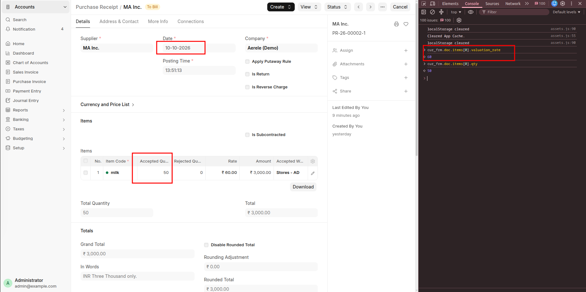

**After:** 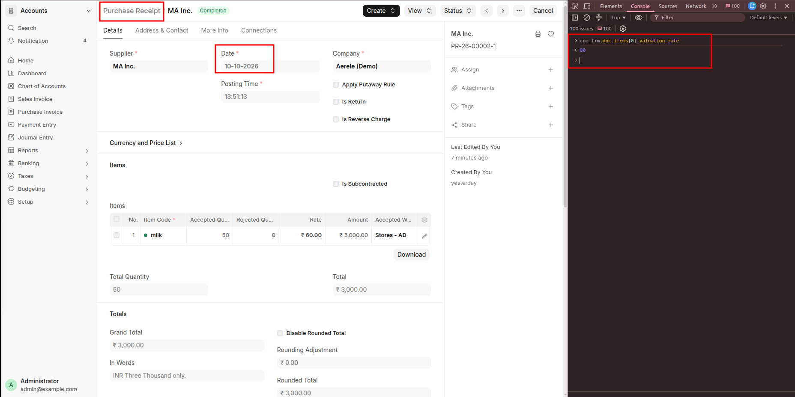

### 15 October: Delivery Note — Milk, 80 L

**Before:** 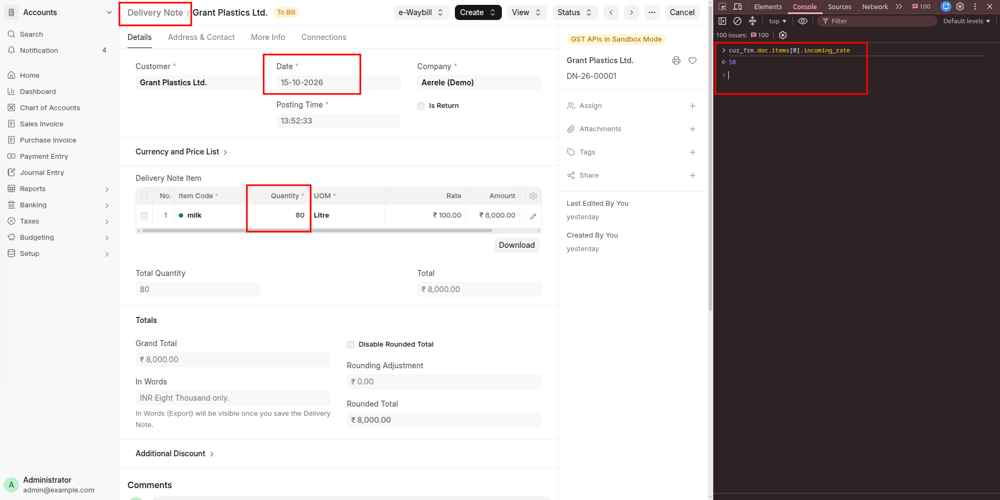

**After:** 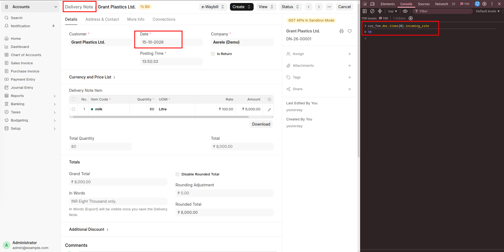

### 20 October: Purchase Receipt — Milk, 50 L

**Before:** 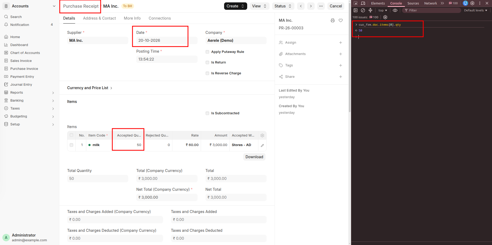

**After:** 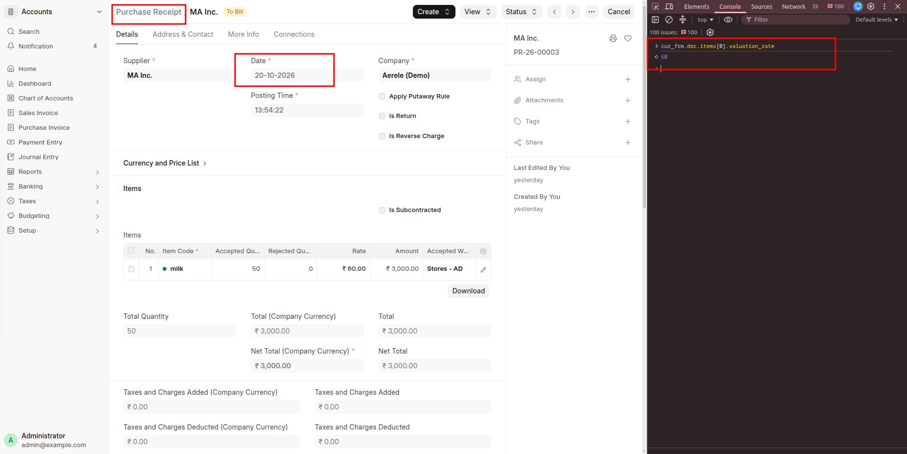

### 21 October: Stock Entry (Manufacture) — 100 L Milk to 10 kg Milk Powder

Include both the consumed Milk and produced Milk Powder rows with their valuation amounts.

**Before:** 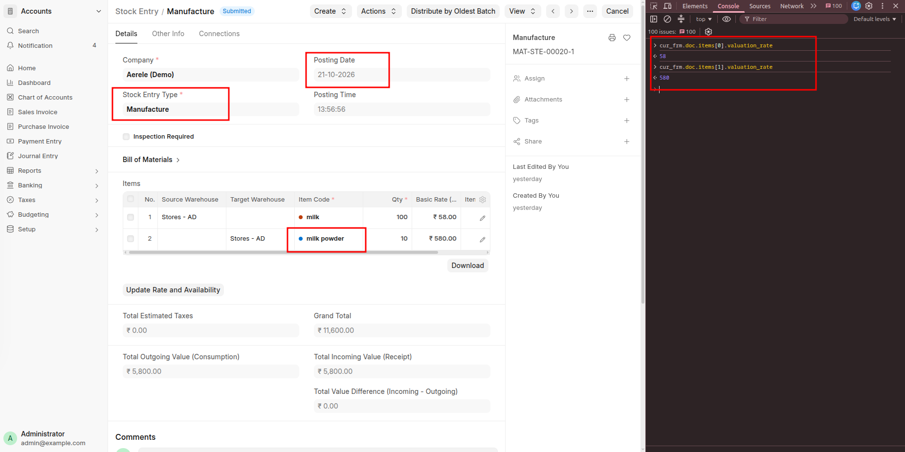

**After:** 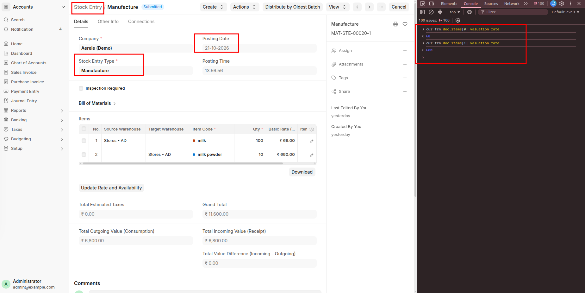

### 25 October: Delivery Note — Milk Powder, 10 kg

**Before:** 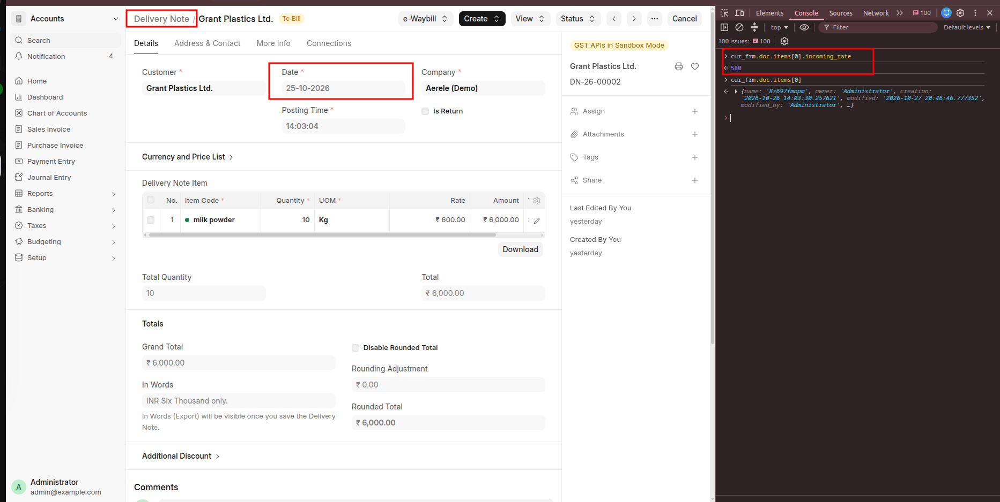

**After:** 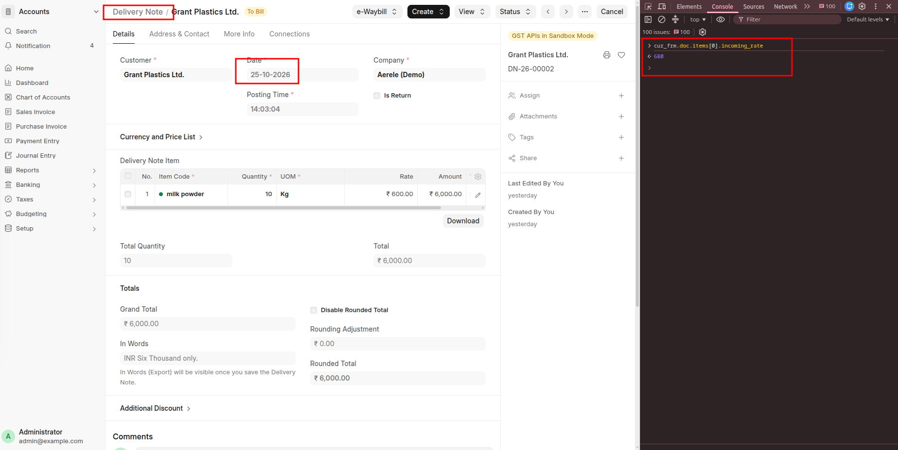

### Stock Ledger report — Milk

Include the opening stock and all subsequent Milk transactions, with quantity, movement value and balance value columns.

**Before:** 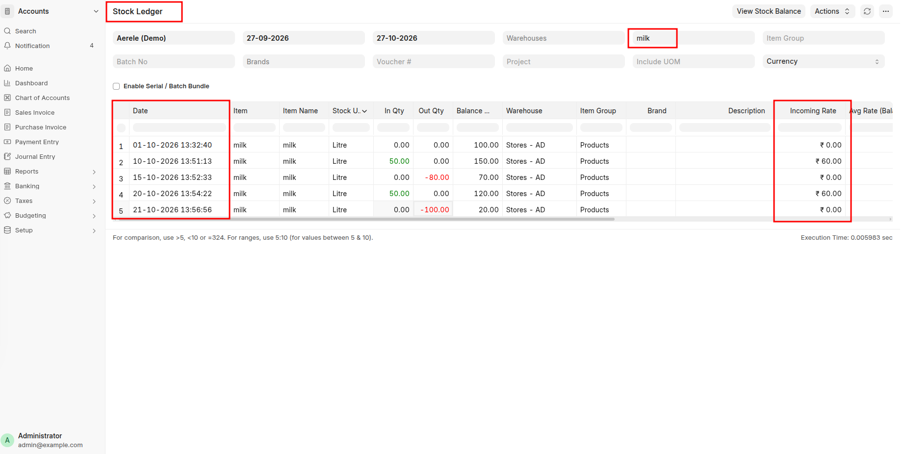

**After:** 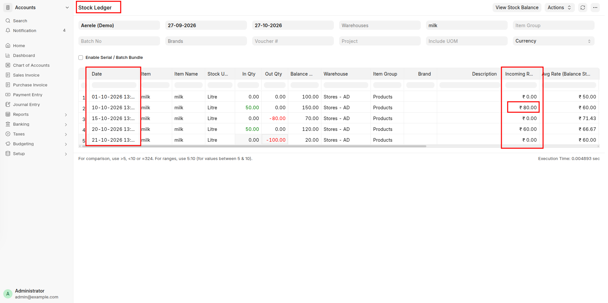

### Stock Ledger report — Milk Powder

Include the manufacturing receipt and final delivery, with quantity, movement value and balance value columns.

**Before:** 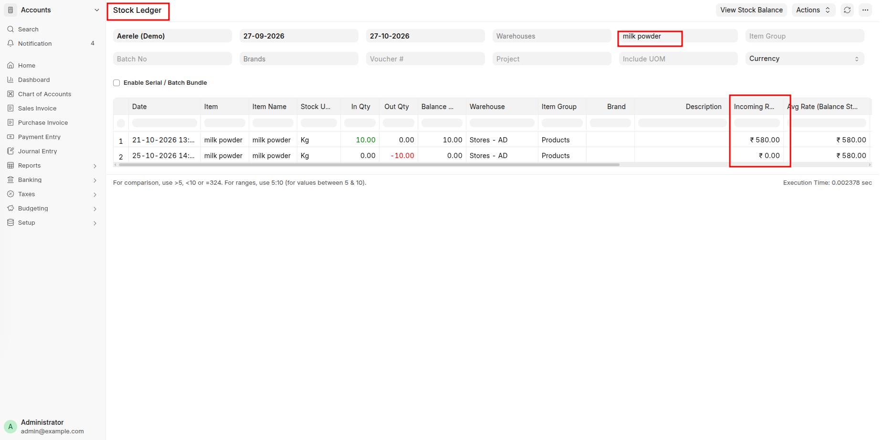

**After:** 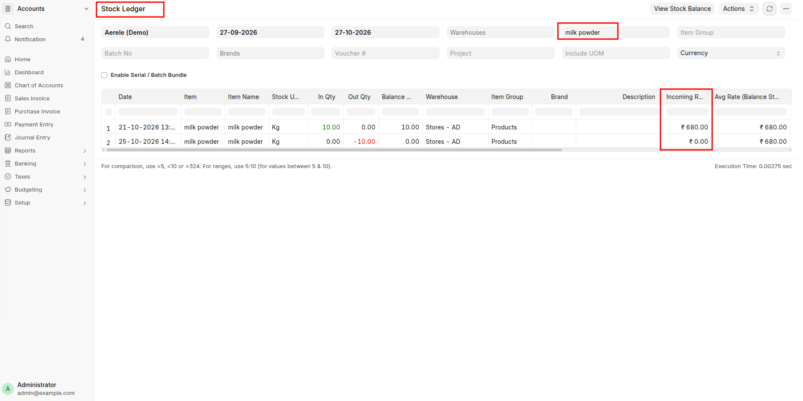

## 2) How should ERPNext recalculate the valuation of the subsequent transactions?

Start from the valid FIFO queue immediately before the corrected receipt and replay subsequent transactions in posting order. Each issue consumes the oldest stock first. Manufacturing transfers the recalculated Milk cost to Milk Powder.

| Date | Recalculation | FIFO queue after transaction |
|---|---|---|
| **Oct 10 — Milk receipt** | Add 50 L at the corrected rate of ₹80/L. | Milk: `[100 @ 50, 50 @ 80]` |
| **Oct 15 — Milk delivery** | Consume 80 L from the opening layer: `80 × 50 = ₹4,000`. | Milk: `[20 @ 50, 50 @ 80]` |
| **Oct 20 — Milk receipt** | Add 50 L at its unchanged rate of ₹60/L. | Milk: `[20 @ 50, 50 @ 80, 50 @ 60]` |
| **Oct 21 — Manufacture** | Consume `20 × 50 + 50 × 80 + 30 × 60 = ₹6,800`. Produce 10 kg Powder at `₹6,800 ÷ 10 = ₹680/kg`. | Milk: `[20 @ 60]`; Powder: `[10 @ 680]` |
| **Oct 25 — Powder delivery** | Consume 10 kg at ₹680/kg: `₹6,800`. | Powder: empty |

For each replayed Stock Ledger Entry, recalculate the FIFO queue, running stock value, valuation rate and stock value difference. Quantities remain unchanged. Continue through the dependent Milk Powder entries, including its delivery.

## 3) How would you design the reposting logic to handle this change for FIFO?

I would rebuild the costs from the transaction history. The receipt correction can affect later deliveries and the cost of another item made from that stock.

1. Find the changed receipt and apply the new rate to a copy of the transactions. Keep the original history for comparison.
2. Replay both histories in posting order. Use a fixed sequence when transactions have the same posting time.
3. Keep a separate FIFO queue for each item and warehouse. A receipt adds a layer; an issue consumes the oldest layers first.
4. For manufacturing, consume the raw materials first. Use their total cost, plus any additional manufacturing cost, as the finished product's incoming value. Then process its later transactions.
5. Rebuild each ledger row's quantity balance, stock value, valuation rate, value difference and FIFO queue. Compare the two results and return the changed rows.

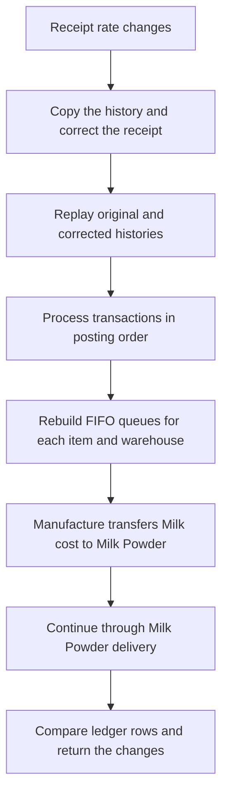

I would use `Decimal` for costs and keep rounding remainders in the remaining FIFO layer. An issue with insufficient stock should fail before consuming any layers. Repeating the same correction should give the same result, without adding the cost difference again.

The final Milk balance is still ₹1,200 in this example, but that does not mean the repost can stop there. The extra ₹1,000 has moved into Milk Powder and must reach its delivery cost.

The Python implementation replays the full supplied history in memory for one company. For a production version, I would start from a valid FIFO checkpoint before the earliest affected transaction and follow dependent manufacturing and transfer entries. Queues would also be scoped by company. A background job would protect affected stock from concurrent changes and publish the recalculated ledger, stock balances and related accounting updates together, so a failure cannot leave partial results.

## 4) What problems could occur if the system stores a running balance in every Stock Ledger Entry?

Running balances make reports faster, but an earlier correction can cause these problems:

1. **Later balances become outdated.** The October 15 delivery cost stays ₹4,000, but its remaining stock value changes from ₹4,000 to ₹5,000. Updating only the receipt leaves the later balance wrong.
2. **Reposting can be slow.** One old receipt correction may require replaying thousands of subsequent entries and updating their changed balances.
3. **A failed repost can leave mixed results.** If only some updates are saved, reports can show old and corrected balances together.
4. **Concurrent transactions can use an old balance.** A new stock entry posted while reposting is running needs coordination with that job to avoid conflicting updates.
5. **The balance does not describe FIFO order.** `[10 @ 50, 10 @ 70]` and `[10 @ 70, 10 @ 50]` both contain 20 units worth ₹1,200. But the next 10-unit issue costs ₹500 in the first queue and ₹700 in the second. FIFO layers must be retained or rebuilt from transaction history.
6. **The final balance can hide changed costs.** Milk still closes at ₹1,200, but manufacturing and Powder delivery costs increase by ₹1,000. Adding ₹1,000 to every later Milk balance would be wrong.

I would treat running balances as calculated results and rebuild them from transactions and FIFO layers. The updated balances and dependent entries should be saved consistently.

## 5) Write a small implementation/design or code change to demonstrate your approach.

- Implementation: `stock_reposting.py`
- Tests: `test_stock_reposting.py`
